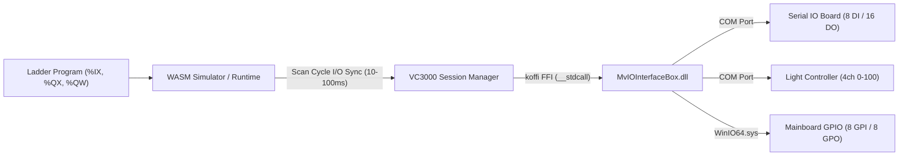

# Implementation Plan: HIK VC3000 Device & TCP/IP Ladder Function Blocks

## Goal Description

This plan adds two major capabilities to **BitmapPLC** while preserving all existing layouts, panels, and workflows:

1. **HIK VC3000 Hardware Target (Windows x64)**:
   - Integrates the Hikvision VC3000 Vision Controller SDK (`MvIOInterfaceBox.dll`, `MvSerial.dll`, `WinIo64.dll`) from `D:\Acer-File\Training\VibeCode\MV-VC-VB-IO-SDK_V2.0.0_Build240318` using **`koffi`** (zero-rebuild C FFI) in the Electron main process.
   - Exposes **HIK VC3000** as a selectable device target in the existing hardware/device dropdown (`hals.json`).
   - Supports full hardware subsystems: **Serial IO Board** (8 DI, 16 DO), **Mainboard GPIO** (8 GPI, 8 GPO via WinIO), and **4-Channel Light Source Controller** (brightness `0–100`, trigger mode, edge, duration), polled synchronously at the PLC scan cycle rate (`10–100 ms`).

2. **General-Purpose Ethernet TCP/IP Server/Client & Ladder Function Blocks**:
   - Adds a new **`Communication`** category to the built-in standard library containing four IEC 61131-3 function blocks: `TCP_SERVER_FB`, `TCP_CLIENT_FB`, `TCP_SEND_FB`, and `TCP_RECV_FB`.
   - Enables ladder diagrams to exchange raw string/byte payloads (e.g., `"Hello world"` with configurable line endings such as `None`, `CR`, `LF`, `CRLF`) with external TCP devices (cameras, handheld scanners, Hercules, etc.).
   - Executes in **both** the **Electron WASM Simulator** (via Node.js `net` module bridged through `simulator-thread`) and **compiled C/C++ targets** (via platform socket / Arduino Ethernet / BSD / Winsock headers).

---

## User Review Required

> **Windows x64 & Administrator Privileges for Mainboard GPIO**
> - The HIK VC3000 SDK (`MvIOInterfaceBox.dll`, `WinIo64.dll`, `WinIo64.sys`) is **Windows x64 only**. On non-Windows hosts, the VC3000 backend will remain inactive/unavailable.
> - Reading/writing **Mainboard GPIO** (`MV_IO_WinIO_Init` / `MV_IO_MainIOInit`) accesses Windows hardware I/O registers via `WinIo64.sys`, which requires **Administrator privileges** on Windows. Serial IO Board (`COMx`) and Light Controller work without elevation.

> **New Dependency: `koffi`**
> - Adding `koffi` to `package.json` provides pure C FFI without requiring `node-gyp` or native C++ compilation against Electron headers.
> - Native DLLs (`MvIOInterfaceBox.dll`, `MvSerial.dll`, `WinIo64.dll`, `WinIo32.sys`, `WinIo64.sys`, `paraCfg.xml`) will be bundled under `resources/bin/win32/x64/vc3000/` and packaged via `electron-builder.json` (`extraResources`).

---

## Proposed Changes

### 1. Native SDK Bundling & Packaging

Copy the 64-bit runtime binaries from `D:\Acer-File\Training\VibeCode\MV-VC-VB-IO-SDK_V2.0.0_Build240318\dll\win64\` into the project so both development (`process.cwd()/resources/bin/win32/x64/vc3000/`) and packaged builds (`process.resourcesPath/bin/vc3000/`) resolve them cleanly.

#### [NEW] `resources/bin/win32/x64/vc3000/`
- `MvIOInterfaceBox.dll`
- `MvSerial.dll`
- `WinIo64.dll`
- `WinIo64.sys`
- `WinIo32.sys`
- `paraCfg.xml`

#### [MODIFY] `package.json`
- Add `"koffi": "^2.9.0"` (or latest stable) to `dependencies`.

#### [MODIFY] `electron-builder.json`
- Existing `win.extraResources` already copies `./resources/bin/win32/${arch}` to `./bin`, which automatically includes the `vc3000/` subfolder and unpacks `*.dll` via `asarUnpack`. Verify `vc3000/` path resolution in both dev and packaged modes.

---

### 2. HIK VC3000 Backend Driver & Hardware Target



#### [NEW] `src/backend/editor/vc3000/vc3000-ffi.ts`
- Uses `koffi` to load `MvIOInterfaceBox.dll` (only when `process.platform === 'win32' && process.arch === 'x64'`).
- Defines exact C structs matching `MvIOInterfaceBoxDefine.h` and `MvIoNative.cs`:
  - `MV_IO_SERIAL` (`strComName[64]`, `nReserved[8]`)
  - `MV_IO_VERSION` (`nMainVersion`, `nSubVersion`, `nModifyVersion`, `nYear`, `nMonth`, `nDay`, `nReserved[8]`)
  - `MV_IO_SET_INPUT`, `MV_IO_SET_OUTPUT`, `MV_IO_OUTPUT_ENABLE`, `MV_IO_INPUT_LEVEL`, `MV_IO_LIGHT_PARAM`
- Binds `__stdcall` functions:
  - Lifecycle: `MV_IO_CreateHandle`, `MV_IO_DestroyHandle`, `MV_IO_Open`, `MV_IO_Close`, `MV_IO_GetSDKVersion`, `MV_IO_GetFirmwareVersion`
  - Serial IO: `MV_IO_SetInput`, `MV_IO_SetOutput`, `MV_IO_SetOutputEnable`, `MV_IO_GetInputLevel`, `MV_IO_GetPortOutputParam`, `MV_IO_ExcutePNPEnable`, `MV_IO_GetPNPEnable`
  - Mainboard GPIO: `MV_IO_WinIO_Init`, `MV_IO_WinIO_DeInit`, `MV_IO_MainIOInit`, `MV_IO_GetMainInputLevel`, `MV_IO_SetMainOutputLevel`, `MV_IO_SetMainGPO_NPN`
  - Light Controller: `MV_IO_SetLightParam`, `MV_IO_GetLightParam`, `MV_IO_SetLightTriggerSource`

#### [NEW] `src/backend/editor/vc3000/vc3000-service.ts`
- Manages connection state for:
  - Serial IO Board (`comPort`, `polarity: 'PNP' | 'NPN'`)
  - Mainboard GPIO (`enabled: boolean`, `polarity: 'PNP' | 'NPN'`)
  - Light Controller (`comPort` or shared handle, 4 channels: `brightness: 0-100`, `state: 'ON' | 'OFF' | 'TRIGGER'`, `edge: 'RISING' | 'FALLING'`, `durationMs`)
- Runs a deterministic **polling loop** (`10–100 ms` configurable) that:
  1. Reads `MV_IO_GetInputLevel` (DI1–DI8 → `%IX0.0–%IX0.7`) and `MV_IO_GetMainInputLevel` (GPI1–GPI8 → `%IX1.0–%IX1.7`).
  2. Writes changed DO1–DO16 (`%QX0.0–%QX1.7`), GPO1–GPO8 (`%QX2.0–%QX2.7`), and Light1–Light4 (`%QW10–%QW13`).
- Cleans up handles (`MV_IO_Close`, `MV_IO_DestroyHandle`, `MV_IO_WinIO_DeInit`) on disconnect or app quit.

#### [NEW] `src/backend/editor/vc3000/index.ts`
- Public barrel export for main process IPC and simulator integration.

#### [MODIFY] `src/backend/shared/firmware/hals.json`
- Add `"HIK VC3000"` board entry:
  - `compiler`: `"simulator"` (executes via Windows host runtime + FFI I/O bridge)
  - `platform`: `"win32-x64"`
  - `specs`: `8 DI / 16 DO (Serial), 8 GPI / 8 GPO (WinIO), 4-ch Light`
  - `default_din`: `"%IX0.0,%IX0.1,%IX0.2,%IX0.3,%IX0.4,%IX0.5,%IX0.6,%IX0.7,%IX1.0,%IX1.1,%IX1.2,%IX1.3,%IX1.4,%IX1.5,%IX1.6,%IX1.7"`
  - `default_dout`: `"%QX0.0..%QX1.7,%QX2.0..%QX2.7"`
  - `default_aout`: `"%QW10,%QW11,%QW12,%QW13"`

#### [MODIFY] `src/main/modules/ipc/main.ts` & `src/middleware/shared/ports/`
- Add IPC handlers for VC3000 (`vc3000:connect`, `vc3000:disconnect`, `vc3000:status`, `vc3000:set-polarity`, `vc3000:set-light`, `vc3000:poll-io`) following existing `hardware` / `device` IPC patterns.

---

### 3. VC3000 Device Configuration UI (Without Changing Existing Layout)

#### [NEW] `src/frontend/components/_features/[workspace]/editor/device/configuration/vc3000-config-panel.tsx`
- Rendered conditionally inside the existing device configuration view **only when `"HIK VC3000"` is selected** in the device dropdown (zero layout impact on other boards).
- Contains:
  - **Connection**: Serial IO COM port selector, Mainboard GPIO toggle (with admin privilege note), Poll Interval (`10–100 ms`), Connect/Disconnect status badge.
  - **Polarity**: Global or DI/DO PNP (default) / NPN selector.
  - **Light Controller (4 Channels)**: Per-channel Brightness slider/input (`0–100`, synced with `%QW10–%QW13`), Mode (`Always On` / `Always Off` / `Trigger`), Edge (`Rising` / `Falling`), Duration (`ms`).
  - **Live I/O Address Reference**: Read-only mapping table showing `%IX0.0–0.7` (DI1–8), `%IX1.0–1.7` (GPI1–8), `%QX0.0–1.7` (DO1–16), `%QX2.0–2.7` (GPO1–8), `%QW10–13` (Light 1–4).

---

### 4. TCP/IP Server & Client Backend Service

#### [NEW] `src/backend/shared/tcp/types.ts`
- Shared types for TCP Server/Client connections, line-ending options (`'NONE' | 'CR' | 'LF' | 'CRLF'`), connection IDs (`connId: number`), and event payloads.

#### [NEW] `src/backend/editor/tcp/tcp-manager.ts`
- Uses Node.js built-in `net` (`createServer`, `Socket`) — zero external dependencies.
- Manages multiple concurrent TCP servers (keyed by `port`) and TCP clients (keyed by `connId` / `host:port`):
  - `startServer(port)` → returns `{ active, clientCount, error }`, assigns numeric `connId` to accepted clients.
  - `connectClient(host, port)` → returns `{ connId, connected, error }`.
  - `send(connId, data, endChar)` → appends `\r`, `\n`, `\r\n`, or nothing according to `endChar` and writes to socket (or broadcasts to server clients if `connId === 0`).
  - `receive(connId)` → pops/reads buffered incoming message `{ newData, data, length, error }` non-blockingly for PLC scan-cycle execution.
  - `stopAll()` → cleanly closes all sockets/servers on simulator stop or app quit.

---

### 5. TCP Function Blocks in Standard Library & Ladder Diagram

#### [NEW] Standard Library `Communication` Category
Add four IEC 61131-3 function blocks to the built-in system library so they appear in the ladder editor block palette under **`Communication`**:

| Function Block | Inputs | Outputs | Behavior |
|---|---|---|---|
| `TCP_SERVER_FB` | `EN (BOOL)`, `PORT (INT)` | `ACTIVE (BOOL)`, `CLIENT_COUNT (INT)`, `ERROR (BOOL)` | Starts/maintains TCP server on `PORT` while `EN` is `TRUE`; stops on `FALSE`. |
| `TCP_CLIENT_FB` | `EN (BOOL)`, `HOST (STRING)`, `PORT (INT)` | `CONNECTED (BOOL)`, `CONN_ID (INT)`, `ERROR (BOOL)` | Connects to `HOST:PORT` while `EN` is `TRUE`; outputs assigned `CONN_ID`. |
| `TCP_SEND_FB` | `EN (BOOL)`, `CONN_ID (INT)`, `DATA (STRING)`, `END_CHAR (STRING)` | `DONE (BOOL)`, `ERROR (BOOL)` | On rising edge of `EN` (or active `EN`), sends `DATA` + `END_CHAR` (`NONE`/`CR`/`LF`/`CRLF`) to `CONN_ID`. |
| `TCP_RECV_FB` | `EN (BOOL)`, `CONN_ID (INT)` | `NEW_DATA (BOOL)`, `DATA (STRING)`, `LENGTH (INT)`, `ERROR (BOOL)` | Polls receive queue for `CONN_ID`; pulses `NEW_DATA = TRUE` for 1 scan when a message arrives. |

#### [MODIFY] Simulator WASM Host Bridge
- `resources/sources/wasm-sim/sim_main.cpp`:
  - Declare WASM host imports (`env.host_tcp_server_step`, `env.host_tcp_client_step`, `env.host_tcp_send`, `env.host_tcp_recv`).
- `src/backend/shared/simulator/wasm-simulator-module.ts` & `src/backend/shared/simulator/simulator-thread.ts`:
  - Bridge `host_tcp_*` calls from the WASM worker thread to `TcpManager` in the Electron main process (using synchronous/shared buffer or pre-scan/post-scan message exchange so scan cycles never stall).

#### [NEW] C/C++ Runtime Code Generation for Physical Targets
- Provide a `plc_tcp.h` / `plc_tcp.cpp` runtime header under `resources/sources/arduino/` (and runtime-v4 C++ bridge) implementing `TCP_SERVER_FB`, `TCP_CLIENT_FB`, `TCP_SEND_FB`, and `TCP_RECV_FB` over BSD sockets / Winsock2 (`_WIN32`) / `EthernetClient`+`EthernetServer` (Arduino).

---

### 6. Architecture Validation

- Register `src/backend/editor/vc3000/` and `src/backend/editor/tcp/` in `src/__architecture__/validate.ts` if any new directory mapping is required, ensuring `npm run validate:arch` passes with zero violations.

---

## Verification Plan

### Automated Tests
1. **Architecture check**:
   ```bash
   npm run validate:arch
   ```
2. **Unit tests**:
   - `src/backend/editor/vc3000/__tests__/vc3000-service.test.ts`: Mock `koffi` bindings, verify handle lifecycle, PNP/NPN bit packing, `%IX`/`%QX`/`%QW` mapping, and light channel parameters.
   - `src/backend/editor/tcp/__tests__/tcp-manager.test.ts`: Spin up real loopback `net.Server` and `net.Socket` instances, verify `TCP_SERVER_FB`, `TCP_CLIENT_FB`, `TCP_SEND_FB` (with `NONE`, `CR`, `LF`, `CRLF`), and `TCP_RECV_FB` message delivery.
   ```bash
   npx jest src/backend/editor/vc3000 src/backend/editor/tcp
   ```
3. **Lint & Build**:
   ```bash
   npm run lint
   npm run build
   ```

### Manual Verification
1. **HIK VC3000 Hardware**:
   - Select `"HIK VC3000"` in the Device Configuration dropdown; verify no existing layout or other boards are altered.
   - Configure COM port, connect, toggle `%QX0.0` in a ladder program, and verify physical DO1 / DI1 (`%IX0.0`) response.
   - Adjust Light Channel 1 brightness (`%QW10` or UI slider) and verify hardware output.
2. **TCP Function Blocks with Hercules**:
   - Open a ladder diagram, insert `TCP_SERVER_FB` (port `5000`), `TCP_RECV_FB`, and `TCP_SEND_FB` (`END_CHAR = 'CRLF'`).
   - Start Simulator, connect **Hercules SETUP utility** as TCP Client to `127.0.0.1:5000`.
   - Send `"Hello world"` from Hercules → verify `NEW_DATA` pulses `TRUE` and `DATA` shows `"Hello world"`.
   - Trigger `TCP_SEND_FB` with `"OK"` + `CRLF` → verify Hercules receives `"OK\r\n"`.
